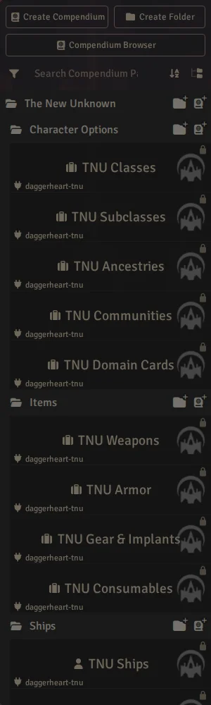
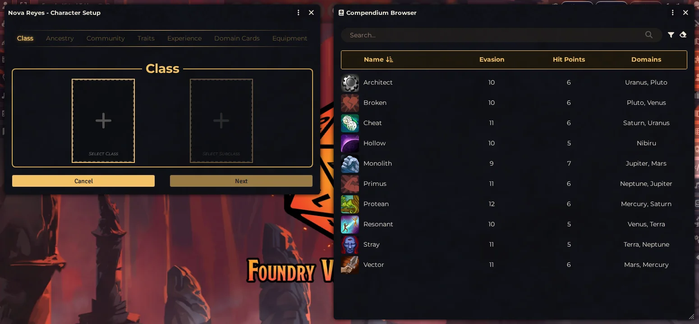
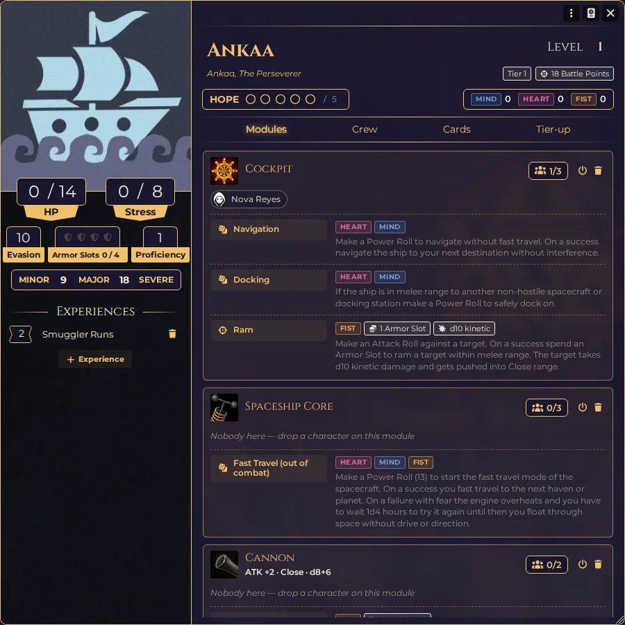
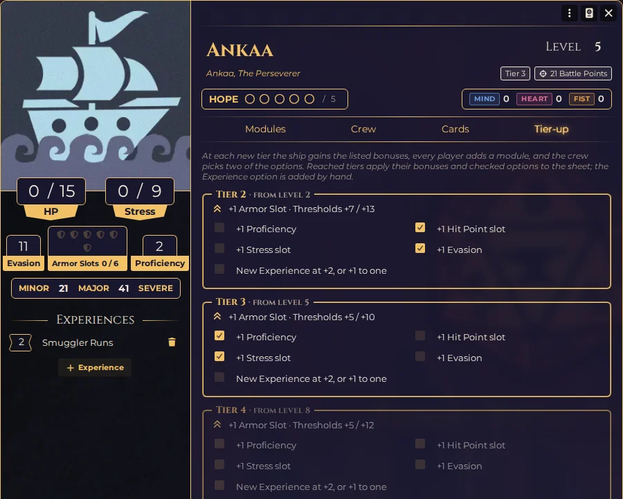
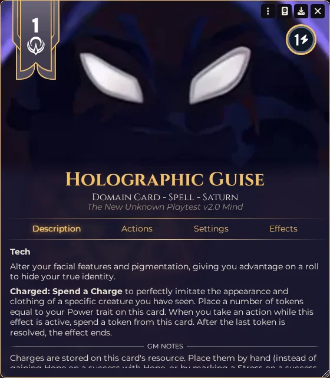
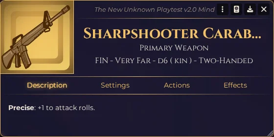
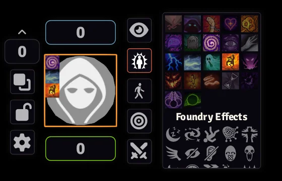

# The New Unknown (Daggerheart)

> [!WARNING]
> **Alpha module.** It stays in alpha until the final version of The New Unknown
> is released. Expect sudden, breaking changes and **data loss** between
> versions: back up your world before updating.
>
> To play a campaign on one version without surprises, **lock** the module: in
> Foundry's setup screen, open **Add-on Modules** and click the lock icon on
> *The New Unknown (Daggerheart)*. A locked package is not updated until you
> unlock it.

The New Unknown (Daggerheart) lets you play The New Unknown, a sci-fi supplement
for Daggerheart, in Foundry. It adds the content of Playtests 1 "Heart", 2 "Mind"
and 3 "Fist": ten classes with their subclasses, ten planetary domains,
ancestries, communities, weapons, armor, adversaries, and two ships the crew
plays from a shared sheet. It also swaps Daggerheart's terms for TNU's, so Scars
read Trauma, Spellcast reads Power, and physical and magical damage read Kinetic
and Energy.

It does not replace Daggerheart. The module sits on top of the system, which
keeps running every roll and rule.

The New Unknown is made by its own authors, not by this module. To get the game
itself and support it:

- [The New Unknown on Kickstarter](https://www.kickstarter.com/projects/1981524065/the-new-unknown-a-sci-fi-role-playing-game)
- [The New Unknown playtest on Heart of Daggers](https://heartofdaggers.com/products/the-new-unknown-2nd-preview-playtest-volume-2-0-mind/)


[](https://buymeacoffee.com/mestredigital) [](https://mestredigital.online/pages/projetos-en)

## Requirements

- Foundry VTT v14.
- The Daggerheart game system, version 2.11.3 or later. The module relies on
  internal structures of the system, so it is tested against that version.
- Recommended: [Distances](https://github.com/brunocalado/daggerheart-distances),
  to see combat ranges on the canvas.

## Installation

In Foundry, go to **Add-on Modules → Install Module** and paste this manifest URL:

```
https://github.com/brunocalado/daggerheart-tnu/releases/latest/download/module.json
```

Then open your Daggerheart world, go to **Settings → Manage Modules**, enable
**The New Unknown (Daggerheart)** and reload when prompted.

## What the module adds

### Compendiums

Everything lives in the **The New Unknown** folder of the Compendium tab, laid
out like the system's own packs:

- Character Options holds the 10 classes (Architect, Broken, Cheat, Hollow,
  Monolith, Primus, Protean, Resonant, Stray, Vector) with their subclasses, plus
  ancestries, communities and domain cards.
- Items holds weapons, armor, consumables, and gear and implants.
- Ships holds the Ankaa and the Taurus, plus ship modules and ship domain cards.
- Next to those folders sit the adversaries, the TNU Gear and TNU Expendables
  rarity tables, and journals with the TNU rules, the ship rules, an overview of
  the classes and domains, and the campaign frames (INSOMNIUM, STARHOPPING,
  X//666: HELLRAVE).



### Character creation with TNU content only

The first time the GM loads the world with the module enabled, the Daggerheart
SRD is hidden from the system's Compendium Browser. The character creator uses
that browser to pick ancestries, communities, classes, subclasses, domain cards
and equipment, so players only see TNU content and your world's own.

To bring the SRD back, open the Compendium Browser as GM, click **Browser
Settings** and enable the **Daggerheart** source again. The module won't hide it
a second time.



### Ships

A Ship actor type with its own sheet, played jointly by the crew:

- The ship has Hit Points, Stress, Hope and Armor Slots, plus Evasion,
  Proficiency and damage thresholds. Adversaries attack and damage a ship like
  any other target.
- When damage would mark Hit Points and the ship has an unmarked Armor Slot,
  whoever applies the damage is asked whether to mark one and reduce the
  severity by one.
- Crew members are placed in modules and use the features of the modules and
  of the ship domain cards with their own Power Trait, paying costs from the
  ship's resources. A cost printed "on a success" is charged only when the roll
  succeeds, and a module's ATK is added to its attack rolls.
- Spaceship Experiences spend ship Hope.
- Raising the level to 2, 5 or 8 adds that tier's Armor Slot and threshold
  raises, and each option the crew checks (two per tier) adds its bonus to the
  sheet.
- Stress past the last slot, from a feature or from damage, deactivates a module
  instead of marking a Hit Point. The GM picks which one from a chat card.
  Resting in the Cabins reactivates every module and recovers the once-per-rest
  features.
- The GM gets a "beyond repair" card when every Hit Point is marked or every
  module is down.

The **Ships** journal has the rules and explains how the sheet runs them.





### Ten new domains

The domain dropdown on Domain Card items lists the TNU planetary domains:

- Mind: Mercury, Saturn, Uranus
- Heart: Pluto, Venus, Terra
- Fist: Neptune, Jupiter, Mars
- Outside the spheres: Nibiru

Each card shows its TNU type, as printed in the playtests: Skill, Tech, Psionic,
Engram, Sigil or Anomaly.



### Weapon and armor keywords

The feature picker on weapon and armor items lists the TNU keywords: 31 for
weapons (Precise, Rupture, Lethal, Tether, Shockwave and more) and 10 for armor
(Adaptive, Phantom, Regrowth, Deflect and more). Hybrid weapons use the system's
Versatile feature, renamed.

When a TNU keyword has the same rule as a Daggerheart feature, it runs that
feature's automation: Precise works like Reliable, Bulky like Heavy, Amplified
like Powerful, Rupture like Brutal. That covers 13 weapon keywords and 4 armor
keywords. The others show the keyword and its rules text, and you apply the
effect at the table.



### New conditions

The TNU conditions appear in the token status menu: Dazed, Distracted, Weakened,
Stunned, Shrouded, Tormented, Ignited, Panicked, Frenzied, Ordered, Infested,
Slowed, Terrified, Confused and Saturated.

- Dazed gives attack rolls a -2 automatically.
- Distracted lowers Evasion by 2 automatically. On an adversary, lower its
  Difficulty by 2 yourself.
- Weakened and Confused add a disadvantage reminder to the roll dialog.
- The rest are markers, and you apply their effect at the table.



Vulnerable, Hidden and Restrained already come with Daggerheart, so they are not
added again.

### Renamed terminology

Only the labels change. The mechanics are identical:

| Daggerheart term | Shown as |
|---|---|
| Scars | Trauma |
| Spellcast / Spellcasting Trait | Power Trait |
| Spellcast Roll | Power Roll |
| Physical damage (Phy) | Kinetic (kin), including resistances and armor rules |
| Magical damage (Mag) | Energy (ene), including resistances and armor rules |
| Versatile weapons | Hybrid |
| Ability / Spell domain cards | Skill, Tech, Psionic, Engram, Sigil, Anomaly, by domain |

### Sci-fi currency

The currency is renamed to Credits. The Handfuls, Bags and Chests tiers stay on,
since TNU prices a new ship at "a chest full of credits". Change it back any time
under **Settings → Daggerheart → Homebrew**.

## Good to know

- Domains, card types, keywords, conditions and labels are added in memory each
  time the world loads, and disappear when the module is disabled. Two settings
  are written once by the GM: the currency rename and the hidden SRD in the
  Compendium Browser. Both can be undone in the system's own settings.
- Works with [Nice Sheets](https://github.com/brunocalado/dh-nice-sheets): the
  TNU domains, keywords, conditions, currency and renamed terms show on its
  character, companion and party sheets too.
- The icons are placeholders. Domains reuse Daggerheart's domain art, and
  conditions use icons from Foundry's built-in library.
- Charges, Echo and the other advanced TNU systems are not automated. They are
  described in the TNU Rules journal and run at the table.

## AI Usage

AI tools were used **only to write the module's code** (JavaScript, CSS and
HTML). All game content (text, rules and descriptions) comes from
Eurydice – Echoes of Ink's *The New Unknown* playtests, is included with the
creators' permission, and was **not** AI-generated or AI-rewritten.

More about how I use AI in my projects: [AI Usage](https://brunocalado.github.io/ai-usage/)

## Legal & Licensing

### Content & Intellectual Property (The New Unknown)
*The New Unknown* is created and copyrighted by **Eurydice – Echoes of Ink**
(Florian, Alexander and Chris). All rules, mechanics, setting lore, names and
original concepts adapted from *The New Unknown* playtest volumes remain the
exclusive intellectual property of Eurydice.

This module is a free, non-commercial community project, published with the
express permission of the creators for use in Foundry Virtual Tabletop. It is
not an official product of Eurydice, and it is not published by them.

To support the original game and get the official rulebooks:

- [The New Unknown on Kickstarter](https://www.kickstarter.com/projects/1981524065/the-new-unknown-a-sci-fi-role-playing-game)
- [Eurydice – Echoes of Ink on Patreon](https://www.patreon.com/c/Eurydice_echoes_of_ink)

### System Compatibility (Daggerheart)
This module adapts content for the *Daggerheart* roleplaying game system.
*Daggerheart* and its trademarks belong to Darrington Press LLC. This community
supplement is distributed in compliance with the
[Darrington Press Community Gaming License (DPCGL)](https://darringtonpress.com/license/).

### Module Code & Assets
- **Module code:** licensed under the
  [GNU General Public License v3.0 (GPLv3)](LICENSE). The game text and
  intellectual property of *The New Unknown* are excluded from the GPLv3.
- **Compendium banner:** [Forward field](https://game-icons.net/1x1/lorc/forward-field.html)
  by Lorc, used under [CC BY 3.0](https://creativecommons.org/licenses/by/3.0/).

# 🧰 My Daggerheart Modules

| Module | Description |
| :--- | :--- |
| 💀 [**Adversary Manager**](https://github.com/brunocalado/daggerheart-advmanager) | Scale adversaries instantly and build balanced encounters. |
| 🖼️ [**Art Mapper**](https://github.com/brunocalado/dh-assets) | Automatically assigns artwork to system compendiums, actors, tokens, and custom module content — keeping your visuals organized and up to date. |
| 🐉 [**Colossus**](https://github.com/brunocalado/dh-colossus) | Manage massive multi-part boss encounters with independent HP per part and a single shared stress pool. |
| 💥 [**Critical**](https://github.com/brunocalado/daggerheart-critical) | Animated criticals. |
| 💠 [**Custom Stat Tracker**](https://github.com/brunocalado/dh-new-stat-tracker) | Add custom trackers to actors. |
| ☠️ [**Death Moves**](https://github.com/brunocalado/daggerheart-death-moves) | Enhances the Death Move moment with a dramatic interface and full automation. |
| 📏 [**Distances**](https://github.com/brunocalado/daggerheart-distances) | Visualizes combat ranges with customizable rings and hover calculations. |
| 📦 [**Extra Content**](https://github.com/brunocalado/daggerheart-extra-content) | Homebrew content pack. |
| 😱 [**Fear Tracker**](https://github.com/brunocalado/daggerheart-fear-tracker) | Adds an animated slider bar with configurable fear tokens to the UI. |
| 🧟 [**Horde**](https://github.com/brunocalado/dh-horde) | Explode single horde tokens into dozens of individual tokens and manage their movement and stats automatically. |
| 🎁 [**Mystery Box**](https://github.com/brunocalado/dh-mystery-box) | Introduces mystery box mechanics for random loot and surprises. |
| 📝 [**Nice Sheets**](https://github.com/brunocalado/dh-nice-sheets) | An alternative character sheet with a resource sidebar, ranked trait plaques, and the character's art filling the background. |
| ⚡ [**Quick Actions**](https://github.com/brunocalado/daggerheart-quickactions) | Quick access to common mechanics like Falling Damage, Downtime, etc. |
| 📜 [**Quick Rules**](https://github.com/brunocalado/daggerheart-quickrules) | Fast and accessible reference guide for the core rules. |
| 🤖 [**Resource Macros**](https://github.com/brunocalado/daggerheart-fear-macros) | Automatically executes macros when the Fear, Hope, Stress, HP, or Armor resources change. |
| 🎲 [**Stats**](https://github.com/brunocalado/daggerheart-stats) | Tracks dice rolls from GM and Players. |
| 🧠 [**Stats Toolbox**](https://github.com/brunocalado/dh-statblock-importer) | Import actors using a statblock. |
| 🛒 [**Store**](https://github.com/brunocalado/daggerheart-store) | A dynamic, interactive, and fully configurable in-game store. |
| 🔍 [**Unidentified**](https://github.com/brunocalado/dh-unidentified) | Obfuscates item names and descriptions until they are identified by the players. |
| 🌌 [**Void**](https://github.com/brunocalado/the-void-unofficial) | Unofficial module that brings The Void playtesting content — experimental classes, subclasses, ancestries, communities, adversaries, loot, weapons, and more. |
